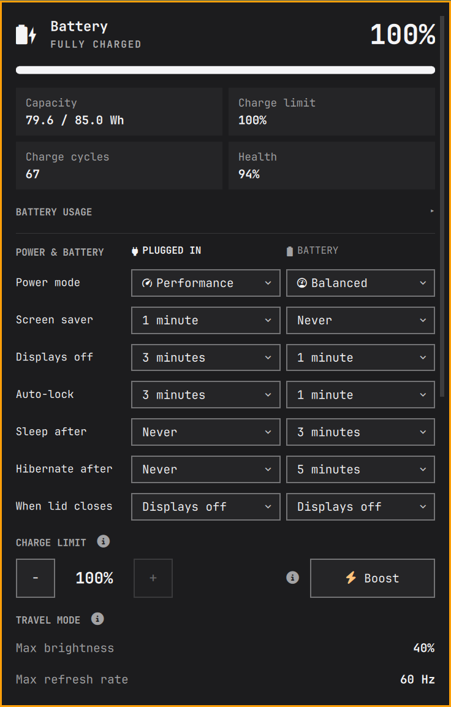
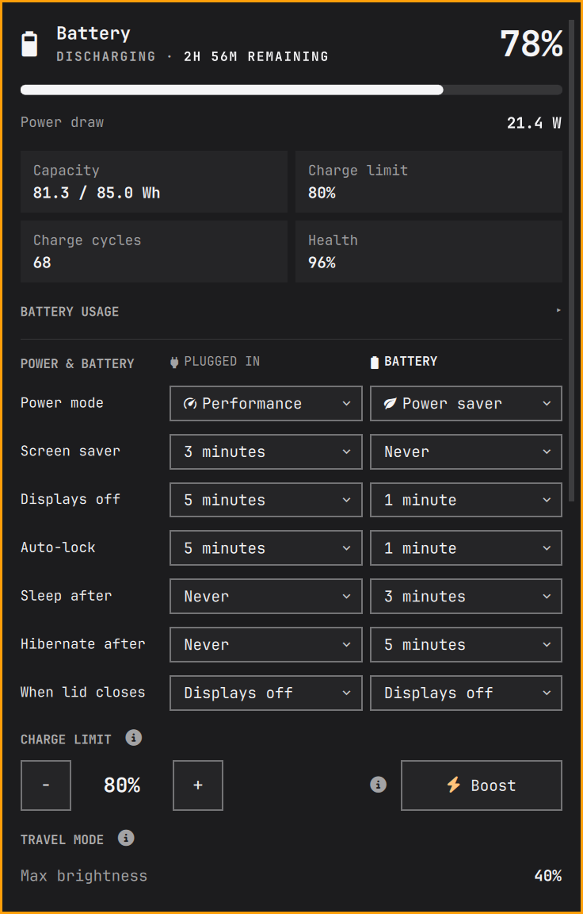

# Omarchy Power Hub

Omarchy Power Hub is a theme-aware power panel and bar widget for Omarchy.

| Plugged in | On battery |
|---|---|
|  |  |

I built this because every other power plugin I tried caused issues on my
Framework Laptop 16. It's the only plugin I'm aware of that works properly on
that machine.

It's developed and tested primarily on the Framework Laptop 16. Other laptops
are supported where they expose the required Linux controls. See
[CHANGELOG.md](CHANGELOG.md) for release history.

## ✨ Supported features

- **Battery status:** charge level, charging state, estimated time remaining,
  live power draw, battery health, charge cycles, and design capacity.
- **Battery history:** expandable 24-hour charge and discharge chart, with
  power readings when available.
- **Sleep drain tracking:** optional measurement of battery use during sleep.
- **Per-power-source plans:** separate settings for plugged-in and battery use:
  power mode, screen saver, displays-off timeout, auto-lock, sleep timeout,
  hibernate timeout, and lid-close action.
- **Display idle control:** turns off every Hyprland output, including external
  displays.
- **Travel mode:** temporarily reduces internal display brightness and refresh
  rate, and applies supported power-saving options. Restore the captured
  settings when turning it off.
- **Quick dim:** temporarily caps brightness and restores the prior level.
  Quick dim is unavailable while Travel mode controls the display.
- **Charging controls:** Framework charge limit and one-time 100% Boost, or a
  UPower battery-health toggle on hardware that exposes charge thresholds.
- **Power tweaks:** optional device power saving for Wi-Fi, PCIe, USB, audio,
  and display settings, depending on available tools and hardware.
- **GPU status:** shows whether a supported discrete GPU is asleep or awake.
- **Framework lighting:** controls supported keyboard and fingerprint power
  button lights, and can keep the keyboard light off when the displays wake in
  daylight.
- **Bar widget:** battery icon and optional percentage, configurable for
  battery and plugged-in states.

The panel uses the active Omarchy theme colors. Features that depend on
hardware, firmware, or optional system services are shown only when available.

## 🚀 Install

```sh
omarchy plugin add https://github.com/JonathanPitre/omarchy-power-hub.git --enable
```

The plugin ships an x86-64 Linux binary and needs no Rust tools. On other CPUs,
the panel says it can't run. Its notices are in
[THIRD-PARTY-LICENSES](THIRD-PARTY-LICENSES).

Optional controls may need additional system tools. For Framework charge
limits, install:

```sh
omarchy pkg add framework-system
```

For the bar percentage, configure **Show percentage on battery** and **Show
percentage when plugged in** in the plugin settings. Right-clicking the bar
widget toggles the percentage for the current power state.

## 🔋 Charging and battery health

On Framework laptops, the charge limit uses `framework_tool --charge-limit`
to set the embedded controller ceiling. It does not use Linux start/stop
threshold files. The default desk-docked limit is 80%; the service reapplies
the saved limit after login if firmware resets it. Boost temporarily charges
to 100%, then restores the saved limit. A passwordless sudoers rule for the
command or a polkit prompt is required. In BIOS, set **Battery charge limit**
to match the plugin (80%) and turn off **Battery Extender**, which can reset the
same control to 100%; see [the longevity note](docs/framework-battery-longevity.md).

On other laptops, **Battery health** appears when UPower reports charge
threshold support. It uses the firmware's charge band when enabled and allows
charging to 100% when disabled. The section stays hidden when thresholds are
not supported.

Do not use this plugin alongside another charge-threshold plugin. Framework
Laptop 16 systems with a USB-C monitor may fail to charge after reconnecting
the adapter; see [the USB-C charging note](docs/framework-16-usb-c-replug-drain.md).

## 🧳 Travel mode and Quick dim

Travel mode caps the internal display at 40% brightness and selects a
supported refresh rate at or below 60 Hz without raising a display already
running slower. External displays are unchanged. It also selects Power saver
when power-profiles-daemon is available, and restores the previous power mode
when disabled. On AMD, that profile disables CPU boost and favors energy
saving. Without power-profiles-daemon, only display controls are changed.

Travel mode enables Panel power saving and Reduce effects if they were off,
then turns them back off when restoring. Plugging in turns Travel mode off;
unplugging does not turn it back on. Wi-Fi, peripherals, and GPU mode are not
changed. If a display setting cannot be restored, the panel keeps the restore
state and offers a retry.

Quick dim independently caps brightness at 40% and restores the captured
level when turned off. It cannot run at the same time as Travel mode because
both controls need to own the display restore state.

## 🛠️ System power controls

Power-saving controls depend on available hardware and system services. TLP
and supported MacBook tunables provide additional power modes and device
controls. The panel can also manage device powersave settings without TLP.
Power plans use Power saver, Balanced, or Performance where supported. New
plugged-in plans default to Performance; new battery plans default to
Balanced.

On a hybrid laptop whose panel is on the AMD iGPU, Omarchy can still point
VA-API at the NVIDIA card. Browser video then stays black, and the discrete
GPU stays awake. The panel only reports that state. See
[the hybrid GPU note](docs/hybrid-amd-nvidia-black-video.md).

Framework keyboard lighting uses `qmk_hid` on Laptop 16 and `framework_tool
--kblight` on Laptop 12 and 13. The fingerprint power button light uses
`/sys/class/leds/chromeos:white:power`, a root-owned device. The first applied
Framework plan may prompt through polkit to install a sudoers rule. To install
that rule manually:

```sh
pkexec bin/ops-priv led-sudoers
```

## 💤 Hibernate and idle locking

Hibernate is unavailable while a process holds `memfd_secret`. Bitwarden
Desktop can do this after login; the panel reports the cause and falls back
to ordinary sleep. See [the hibernation note](docs/hibernate-memfd-secret-bitwarden.md)
for details and a workaround.

On Framework Laptop 16 with AMD Ryzen AI 300, firmware may move an ACPI region
during hibernation resume, causing the kernel to reject the saved image. The
plugin cannot correct this firmware behavior; see
[the Framework resume note](docs/framework-16-hibernate-resume.md).

Quickshell 0.3.1 can lose idle notifications when a running timer changes.
That may prevent automatic locking after displays turn off or wake. See
[the idle timer diagnosis](docs/quickshell-idle-timer-failure.md) for the
installed backport, rollback steps, and verification.

## ⚡ Performance

Panel data and background polling run in a small Rust binary, `bin/power-hub`.
The bar, panel and idle service stay in QML. Saving settings, profiles, Travel,
Quick dim, Power Tweaks, display control, idle lock, screen saver launch, UCSI
recovery and the lid handlers run in the binary too. Nothing needs Python.

Python and Bash (0.0.53) compared with Rust:

| Path | Runs | Time (ms) | CPU (ms) | Processes | Peak memory (MB) |
|---|---|---|---|---|---|
| Idle check | Every second, displays off or parked | 102 → 38 | 96 → 0.9 | 19 → 1 | 18.7 → 0.7 |
| Battery data | Every 5 s, 60 s with panel closed | 89 → 13 | 100 → 4.8 | 100 → 3 | 18.4 → 6.2 |
| Panel status | Panel open, after edits | 273 → 53 | 273 → 35 | 44 → 20 | 31.9 → 7.3 |
| GPU status | Every 5 s, panel open | 39 → 0.9 | 39 → 0.8 | 1 → 1 | 18.7 → 0.7 |
| Small commands | Config, boost check, display sync | 34 → 0.5 | 34 → 0.4 | 1 → 1 | 18.8 → 0.7 |

- The idle check drops from 9.6% to 0.09% of one CPU core while it runs. Its
  remaining 38 ms is mostly waiting on Hyprland.
- Polling with the panel open drops from 2.8% to 0.11% of one core.
- The NVIDIA GPU stayed asleep through six 60 s polling windows, three on each
  backend.

These figures come from one Framework Laptop 16, plugged in, on the Performance
profile, with the display on. Time and CPU are medians of 15 runs, and memory of
5. Peak memory is the largest single process, including tools a command starts.
Hyprland's own work is not counted.

Battery draw with the display on showed no clear change: a median of 18.0 W
before and 17.2 W after, across five 60 s windows each. That gap is within the
noise, and the idle check doesn't run in this test.

## 📚 Troubleshooting notes

- [Slow display lock and wake](docs/slow-display-lock-wake.md)
- [Cursor screensaver workaround](docs/cursor-screensaver-workaround.md)
- [Framework 16 USB-C charging after replug](docs/framework-16-usb-c-replug-drain.md)
- [Framework battery longevity: BIOS limit and Battery Extender](docs/framework-battery-longevity.md)
- [Framework 16 hibernate resume](docs/framework-16-hibernate-resume.md)
- [Hibernation blocked by `memfd_secret`](docs/hibernate-memfd-secret-bitwarden.md)
- [Quickshell idle timer failure](docs/quickshell-idle-timer-failure.md)
- [Hybrid AMD + NVIDIA: black video and a discrete GPU that stays awake](docs/hybrid-amd-nvidia-black-video.md)
